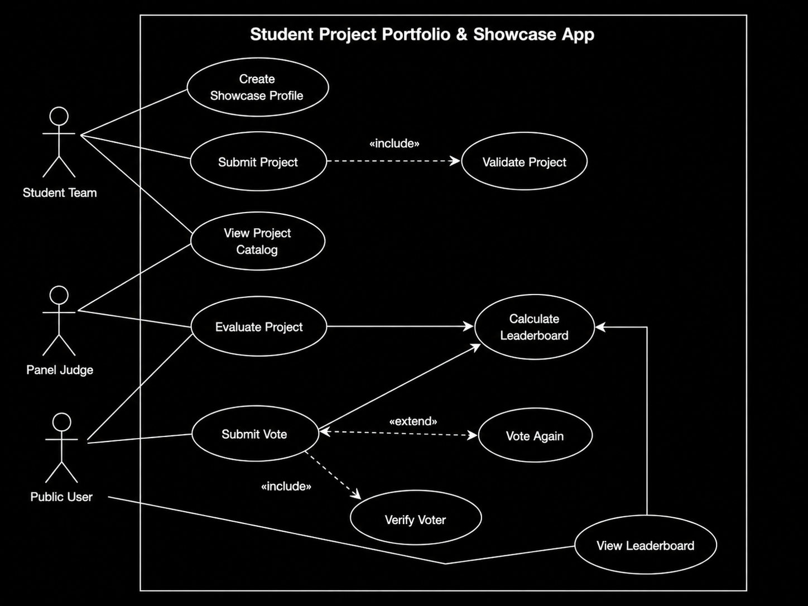

# Requirements Engineering and UML Use-Case Modelling

## Project Overview

This repository contains the deliverables for **Lab 1 – Requirements Engineering and UML Use-Case Modelling**.

The work focuses on documenting project requirements, organizing use-case information, and representing system interactions through UML use-case diagrams.

## Objectives

- Understand the fundamentals of Requirements Engineering.
- Identify and document project requirements.
- Organize requirements in a structured requirements table.
- Model system interactions using UML Use-Case Diagrams.
- Document the use-case flow and supporting project details.

## Repository Contents

| File / Folder | Description |
|---|---|
| `UML/` | UML-related project resources |
| `Use_Case_Diagram.drawio` | Editable UML use-case diagram |
| `Use_Case_Diagram.png.png` | PNG version of the use-case diagram |
| `Submit_Project_Use_Case_Flow.docx.docx` | Use-case flow documentation |
| `Submit_Project_Use_Case_Flow.pdf.pdf` | PDF version of the use-case flow |
| `requirement_table.docs.docx` | Requirements documentation in Word format |
| `requirement_table.pdf.pdf` | Requirements documentation in PDF format |

## Use-Case Diagram

The following image provides a visual representation of the use-case diagram.

## Tools Used

- **Draw.io:** Creating and editing UML diagrams.
- **Microsoft Word:** Preparing project documentation.
- **PDF:** Sharing finalized documentation.
- **GitHub:** Version control and project submission.

## Learning Outcomes

- Understanding functional requirements and requirements documentation.
- Representing system functionality using UML.
- Understanding actors, use cases, and system interactions.
- Organizing and maintaining software engineering project deliverables.

## Repository

GitHub: [student-project-portofolio-showcase](https://github.com/sowmyashree3924/student-project-portofolio-showcase)

---

*Academic work – Requirements Engineering and UML Use-Case Modelling, Lab 1.*
